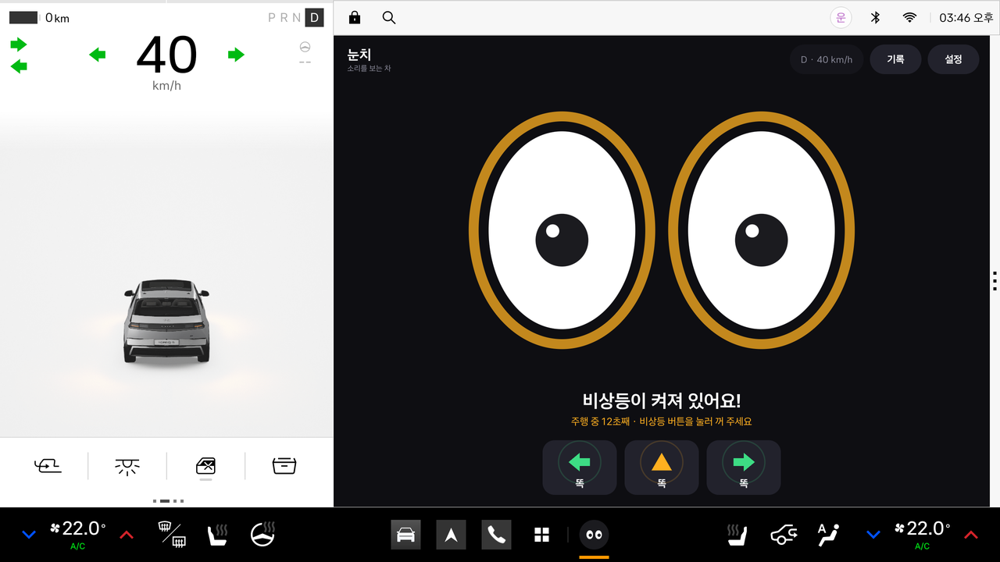
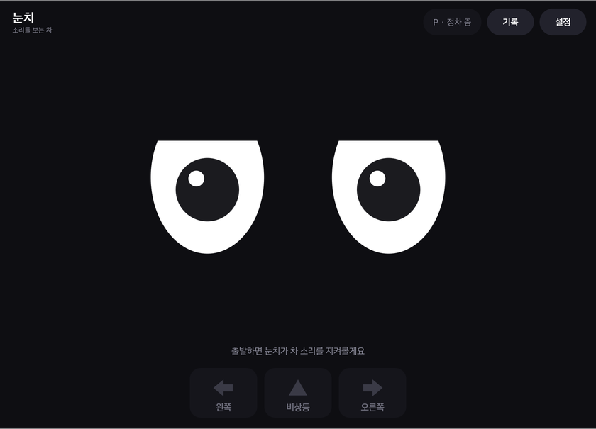
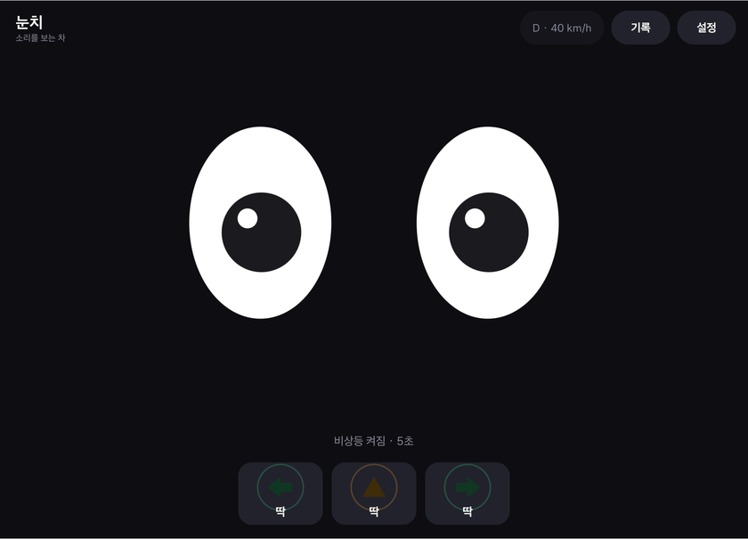
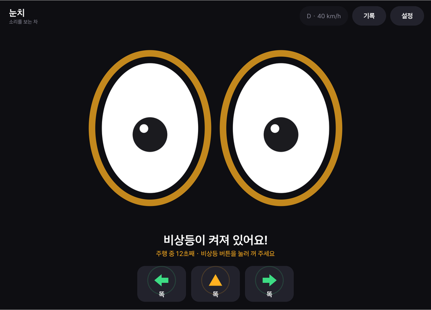
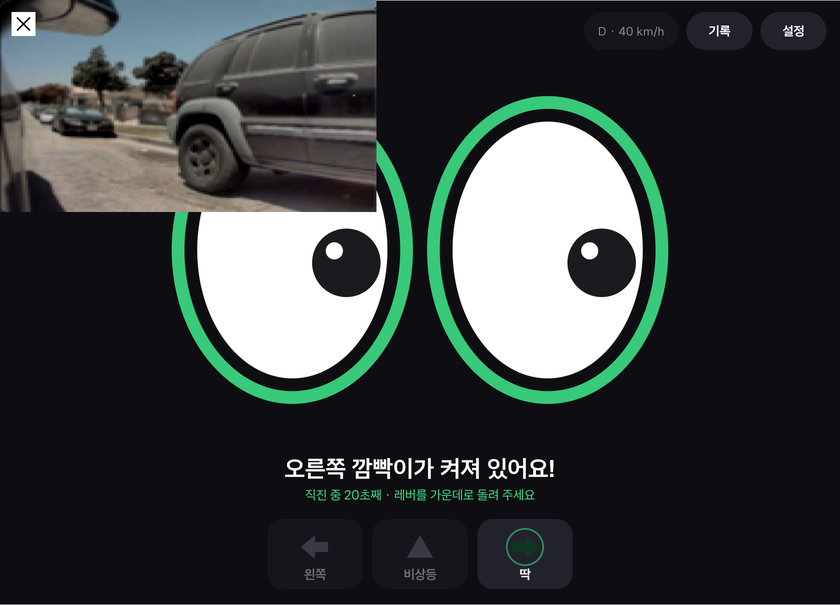
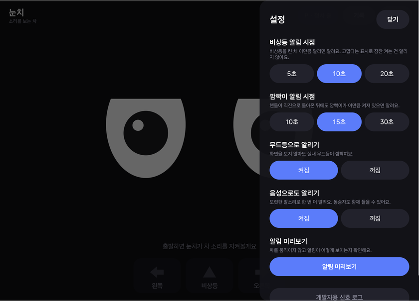
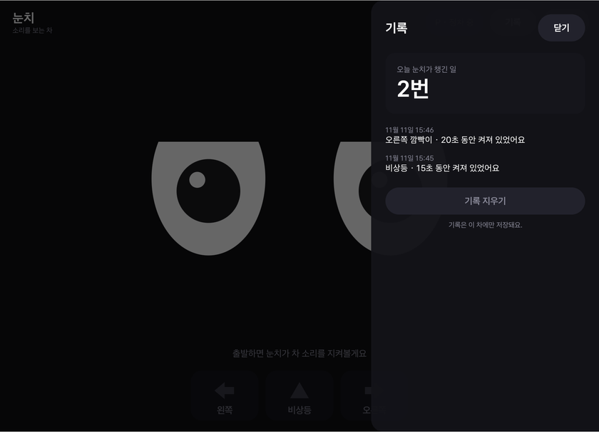

# 눈치 (Nunchi)

**소리를 보는 차.** 비상등·깜빡이의 "똑딱" 소리를 듣지 못해 켜 둔 채 달리는 운전자에게, 차가 내는 소리를 눈 캐릭터와 무드등, 음성으로 대신 알려 주는 Pleos Connect 앱입니다.

> "저는 비상등을 켜고 한참 달린 적이 있습니다. 똑딱 소리가 안 들렸거든요."



## 무엇을 하나요

| 상황 | 판단 기준 | 알림 |
|---|---|---|
| 비상등을 켠 채 주행 | 주행 중 10초 넘게 켜져 있음 (고맙다는 표시로 2~3초 켜는 것과 구분) | 눈이 커지고 주황 테두리 + 무드등 주황 깜빡임 + 음성 "비상등이 켜져 있어요" |
| 깜빡이를 켠 채 주행 | 핸들이 직진(±10°)으로 돌아온 뒤 15초 넘게 켜져 있음 | 눈이 그 방향을 보며 초록 테두리 + 무드등 초록 깜빡임 + 음성 |
| 알렸는데도 20초 더 켜져 있음 | 위 알림 이후 20초 | 눈이 좌우로 떨림 + 무드등 두 배 빠르게 + 음성 "아직 …켜져 있어요" |
| 끔 | 신호가 꺼짐 | 바로 웃는 눈 "꺼졌어요 👍", 무드등은 원래 색으로 복원 |

| 정차 중 | 켜진 지 몇 초인지 표시 | 비상등 알림 | 깜빡이 알림 |
|---|---|---|---|
|  |  |  |  |

### 세부 기능

- **똑딱 소리를 눈으로**: 화면 아래 표시기(왼쪽·비상등·오른쪽)가 실제 깜빡이와 같은 빠르기(약 0.35초 간격)로 켜졌다 꺼지고, 소리가 퍼지듯 고리가 번지며 글자가 "똑"과 "딱"으로 바뀝니다. 비상등은 실제 차처럼 세 개가 함께 깜빡입니다.
- **화면을 보지 않아도**: 앱을 열어 두지 않아도(내비를 보고 있어도) 뒤에서 계속 지켜보다가 **무드등과 음성**으로 알립니다. 시동을 걸면 자동으로 시작합니다.
- **알림 전 카운트**: 신호가 켜지면 "비상등 켜짐 · 4초"처럼 몇 초째인지 보여 줍니다. 회전·차선 변경으로 핸들을 돌리고 있는 동안은 시간이 쌓이지 않습니다.
- **눈 캐릭터**: 정차 중에는 눈꺼풀을 반쯤 내리고 쉬고, 달리면 눈을 크게 뜨고, 가끔 깜빡이거나 옆을 살핍니다.
- **설정**: 알림 시점(비상등 5·10·20초, 깜빡이 10·15·30초), 무드등·음성 켜고 끄기, **알림 미리보기**(차량 신호 없이 알림을 체험).
- **기록**: 오늘 눈치가 챙긴 횟수와 최근 알림 내역. 이 차에만 저장하고 밖으로 보내지 않습니다.
- **운전에 집중**: 주행 중에는 설정·기록을 열 수 없고, 열려 있었다면 출발할 때 닫힙니다.

| 설정 | 기록 |
|---|---|
|  |  |

## 사용한 Pleos Connect SDK

| 기능 | SDK / API | 권한 |
|---|---|---|
| 방향지시등 상태 | Vehicle SDK 2.3.2 `TurnSignal.registerTurnSignalState` | `pleos.car.permission.CAR_LIGHTS` |
| 핸들 각도, 브레이크 | Vehicle SDK `SteeringWheel.registerSteeringWheelAngle`, `Brake.registerBrakePedalStatus` | `pleos.car.permission.CAR_DRIVE` |
| 비상등 판별 (계기판 경고등) | Vehicle SDK `Safety.getTelltalesInfo` (0.5초마다 조회) | `pleos.car.permission.CAR_SAFETY`, `PRIVATE_CAR_SAFETY` |
| 무드등 색 읽기·복원 | Vehicle SDK `Light.getAmbientLightBrightnessColor`, `checkAmbientLightBrightnessColorCapabilities` | `pleos.car.permission.CAR_LIGHTS` |
| 무드등 깜빡임 | Vehicle SDK `Light.setAmbientLightBrightnessColor` | `pleos.car.permission.CONTROL_CAR_LIGHTS` |
| 음성 안내 | TextToSpeech SDK 3.3.1 (`Mode.ON_DEVICE`, 앱 등록·통신 불필요) | `pleos.car.permission.TTS_SERVICE` |
| 속도, 기어 | AAOS `PERF_VEHICLE_SPEED`, `GEAR_SELECTION` (Vehicle SDK가 Gear API 대신 쓰라고 안내하는 표준 속성) | `android.car.permission.CAR_SPEED`(실행 시 허용), `CAR_POWERTRAIN` |

**비상등을 어떻게 아나요?** 비상등을 직접 알려 주는 AAOS `HAZARD_LIGHTS_STATE`는 시스템 앱 전용 권한이라 읽을 수 없고, 비상등을 켜도 Vehicle SDK의 방향지시등 값은 OFF 그대로입니다. 그래서 실제 차에서 비상등을 켜면 계기판의 좌·우 화살표 경고등이 **동시에** 켜진다는 점을 이용해, 경고등 목록에서 `TURN_SIGNAL_LEFT`와 `TURN_SIGNAL_RIGHT`가 함께 켜져 있으면 비상등으로 판단합니다. (SDK 2.3.2 구현은 경고등 조회 때 `PRIVATE_CAR_SAFETY`도 확인하며, 에뮬레이터 v2.1.0에서 일반 권한으로 부여됩니다.)

## 테스트 환경

| 항목 | 내용 |
|---|---|
| 에뮬레이터 | **Pleos Connect Emulator v2.1.0** (Android 14, API 34, Automotive, x86_64) |
| 화면 규격 | **2560 × 1440 px, 160 dpi (mdpi), 12.8인치 가로**. 앱은 화면 오른쪽 영역(약 1680 × 1210 px)에 표시됩니다 |
| 빌드 | Android Gradle Plugin 8.7.3 / Gradle 8.11.1 / Kotlin 2.1.21 / JDK 17 이상 |
| 앱 | minSdk 28, targetSdk 34, compileSdk 35 |

## 실행 방법

### 1. 에뮬레이터 준비

1. Android Studio → SDK Manager → SDK Update Sites에 Pleos Connect System Image 추가
   - URL (Windows/Linux): `https://nexus-playground.pleos.ai/repository/raw-releases/connect-avd/2.x/crp-sys-img.xml`
2. SDK Platforms → Show Package Details → Android 14.0 → **Pleos Connect v2.1.0 APIs Intel x86_64 Atom System Image** 설치 후 Android Studio 재시작
3. Device Manager → Automotive → **Pleos Connect v2.1.0** AVD 생성 (Boot option은 반드시 **Cold boot**)

### 2. 앱 설치

```bash
adb install apk/눈치팀_눈치_release.apk      # 또는 Android Studio에서 이 프로젝트를 열고 app 실행
```

처음 실행하면 안내 화면이 나옵니다. **시작하기**를 누르고 권한 두 가지(차량 속도 – 화면에는 "위치 정보"로 표시됩니다, 알림)를 허용해 주세요. 거부해도 동작합니다(속도 대신 기어·브레이크로 주행을 판단).

### 3. 가장 빠른 확인: 알림 미리보기

차량 신호를 넣지 않고도 **설정 → 알림 미리보기**를 누르면 7초 동안 비상등 알림(눈, 무드등, 음성)을 볼 수 있습니다.

### 4. Virtual Console로 실제 신호 넣기

```bash
adb forward tcp:8088 tcp:8088     # 그다음 PC 브라우저에서 http://127.0.0.1:8088/
```

Emulation Controls에서 다음 순서로 조작합니다.

**깜빡이 (S2)**
1. Motion → Gear Selection **D**, Brake Pedal **0%**
2. Convenience → Turn Signal State **Blink right** (Steering Angle은 0°)
3. 15초 뒤 알림 → Turn Signal State **Off**로 해제

**비상등 (S1)**
1. Motion → Gear Selection **D**, Brake Pedal **0%**
2. Convenience → Hazard Lights **On**
3. Safety → Telltales → **Turn Signal Left**와 **Turn Signal Right**를 각각 **Blink**
4. 10초 뒤 알림 → 3번의 두 경고등을 **Off**로 해제

> ⚠️ 에뮬레이터의 Hazard Lights 카드는 계기판 화살표 경고등까지 켜 주지 않습니다. 실차에서는 비상등 스위치가 두 경고등을 함께 켜므로, 에뮬레이터에서는 3번을 직접 해 주어야 합니다.

### 5. 스크립트로 한 번에 (Python 3, 추가 설치 없음)

위 조작을 순서대로 대신 해 줍니다.

```bash
adb forward tcp:8088 tcp:8088
python tools/virtual_console.py hazard   # 비상등을 켠 채 주행 → 알림 → 끄기
python tools/virtual_console.py signal   # 깜빡이를 켠 채 직진 → 알림 → 끄기
python tools/virtual_console.py reset    # 모두 끄고 P단
```

> 에뮬레이터 안에서 재부팅(`adb reboot`)하면 Virtual Console이 `emulator_inactive`가 됩니다. 에뮬레이터를 껐다가 다시 켜 주세요.

## 빌드

```bash
./gradlew :app:testDebugUnitTest   # 판단 로직·기록 단위 테스트 19개
./gradlew :app:assembleRelease     # app/build/outputs/apk/release/app-release.apk
```

`keystore.properties`가 없으면 release도 debug 키로 서명되므로, 저장소를 내려받아 바로 빌드해 볼 수 있습니다.

## 코드 구조

```
app/src/main/java/com/nunchi/app/
├─ NunchiService.kt        포그라운드 서비스. 신호를 지켜보다가 무드등·음성·알림으로 알림
├─ BootReceiver.kt         시동 후 자동 시작
├─ MainActivity.kt         화면 (상태를 받아 그리기만 함)
├─ NunchiHub.kt            서비스 ↔ 화면 상태 전달
├─ alert/AlertEngine.kt    판단 로직 (순수 Kotlin, 단위 테스트)
├─ alert/AlertHistory.kt   알림 기록
├─ vehicle/                VehicleMonitor(Pleos Vehicle SDK + AAOS 속성), VehicleState
├─ output/                 AmbientLightController, VoiceAnnouncer(Pleos TTS), AlertNotifier
├─ settings/               사용자 설정
└─ ui/                     EyeView(눈 캐릭터), SoundIndicatorView(똑딱 표시기)
tools/virtual_console.py   Virtual Console 조작 스크립트
```

## 알려진 제약과 다음 단계

- Pleos Connect는 화면 위 팝업 알림을 시스템 앱에만 허용합니다. 다른 앱을 보고 있을 때는 무드등과 음성으로 알리고, 시스템 알림은 알림 센터에 남습니다.
- 다음 단계(공개 SDK 범위가 넓어지면): 사이렌·경적 같은 바깥 소리, 뒷좌석 아이 울음 등 사람 소리, 안전벨트·문 열림 경고음으로 확장.

## APK 위치

[`apk/눈치팀_눈치_release.apk`](apk/눈치팀_눈치_release.apk) (release 빌드, v0.2.1)
